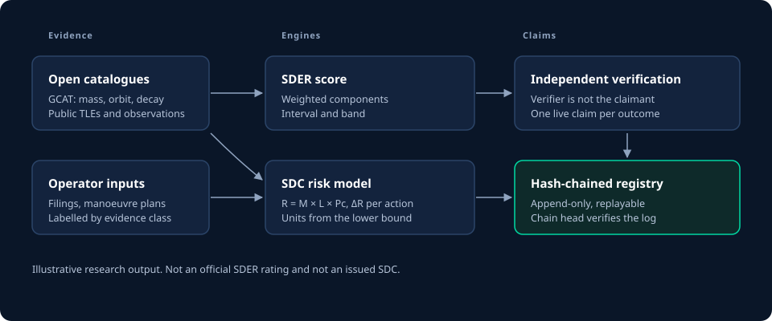

<p align="center">
  <picture>
    <source media="(prefers-color-scheme: dark)" srcset="brand/primary_dark.svg">
    
  </picture>
</p>

# SDC and SDER

**Space Debris Credit (SDC)** and **Space Debris Exposure Rating (SDER)** form an open research programme on two questions. How can a space mission's debris exposure be shown together with what is not known about it? And how can a verified reduction in long-lived debris risk be recognised without double counting or paying for what would have happened anyway?

[](https://github.com/esp75/sdc-sder/actions/workflows/ci.yml)
[](LICENSES/Apache-2.0.txt)
[](LICENSING.md)
[](REUSE.toml)


> **Status: v0.2, open for consultation and for outside peer review.** No official SDER rating, issued SDC, certification or market exists. The code produces *illustrative research outputs*. Method v0.2 calibrates two of its tables from open data; the other parameters are still placeholders.

A research programme of the **SDC Institute** (in formation) · originated by **Maxime Kadri** · [Disclosures](DISCLOSURES.md)

## Documentation

The documentation follows the [Diátaxis](https://diataxis.fr/) framework. Pick the quadrant that matches what you need.

| | |
|---|---|
| **[Tutorials](docs/tutorials/01-score-a-mission.md)** | Learn by doing: score a mission, then rank real debris by risk |
| **[How-to guides](docs/how-to/read-a-score.md)** | Solve one task: read an uncertainty, compare removals, verify a registry, refresh the data |
| **[Reference](docs/reference/cli.md)** | Look up exact commands, the scoring model and its fields |
| **[Explanation](docs/explanation/how-sder-works.md)** | Understand the design: why SDER works this way, and how claims stay honest |

Start at the [documentation index](docs/index.md).



## Publications

| | |
|---|---|
| **Conference paper** | Kadri & Shishkina, [*Space Debris Credits: A Market-Based Framework for Governance and Environmental Stewardship in Orbit*](papers/2026-strauss-sdc-framework/README.md), Strauss Center Space Traffic Conference 2026, UT Austin |
| **SDC-WP-2026-01** | [Legal pathways for debris remediation under existing space law](papers/wp-01-legal-pathways/README.md) |
| **SDC-WP-2026-02** | [SDER and ΔR: reference methodology, implementation and limits](papers/wp-02-sder-methodology/README.md) |
| **SDC-WP-2026-03** | [Claim integrity without a blockchain](papers/wp-03-claim-integrity/README.md) |
| **SDC-WP-2026-04** | [Ranking LEO objects by R = M × L × Pc with open catalogue data](papers/wp-04-catalogue/README.md) |
| **Principles** | [Vision and Principles v0.1](spec/vision-and-principles-v0.1.md) (CC BY-SA) |
| **Rulebook** | [Consultation draft v0.2](spec/rulebook-v0.2-consultation-draft.md) (CC BY-SA) |
| **For everyone** | Explainers in [English](docs/explainers/en.md) and [French](docs/explainers/fr.md) · [institutional brief](spec/institutional-brief.md) · [consultation template](spec/consultation-template.md) |

Every working paper is open for outside peer review. The [roadmap](papers/ROADMAP.md#outside-peer-review) explains how to submit a review and lists the gaps that remain.

## Main results so far

From the open GCAT catalogue (11 October 2026), WP-04 ranks 18,036 intact objects in low Earth orbit by $R = M \times L \times Pc$:

- Among the 2,845 derelicts, **50 objects hold 46 % of total R**. Most are Zenit-2 upper stages near 840 km and Chinese upper stages launched since 2022.
- **Removing the ten highest-R derelicts gives 80 times the risk reduction** of removing ten at random. Its conservative bound beats 99.5 % of 10,000 random draws.
- The lifetime model behind $L$ was backtested on 404 rocket bodies that have reentered. Its predicted range held the actual lifetime for 96 % of them.

## From paper to code

| Paper (Kadri & Shishkina 2026) | Implementation | What the tests check |
|---|---|---|
| §5 Exposure rating as a weighted sum of normalised factors | [`src/sder`](src/sder/), with versioned method files ([v0.2](src/sder/methodology/research-v0.2.yaml), [v0.1](src/sder/methodology/research-v0.1.yaml)) | Weaker evidence widens the interval. Removing any input never lowers the score. Too much missing data withholds the result. |
| §6 $R_i = M_i \times L_i \times Pc_i$, $\Delta R(a) = \sum_i (R_{i,\text{before}} - R_{i,\text{after}})$ | [`src/sdc/risk.py`](src/sdc/risk.py), `sdc delta-r` | Removal never increases risk. ΔR is additive across objects. Removing the highest-R objects maximises ΔR. Units never exceed the conservative bound. |
| Figures 2–3, on real objects | [`src/sdc/catalogue.py`](src/sdc/catalogue.py), `sdc catalogue` | Lifetime rises with altitude and falls with area-to-mass. Every range contains its point value. WP-04's published numbers match the code. |
| §7 Verification, registry, anti-double-counting | [`src/sdc/registry.py`](src/sdc/registry.py) | A self-verifying or conflicted verifier is refused. A double claim is refused. A forged log fails replay even when all its hashes are recomputed. |

Each principle is enforced in code:

| Principle (v0.1) | Enforcement |
|---|---|
| Distinguish evidence types (SDER 2) | Every input carries `verified`, `independently_observed`, `modeled` or `operator_statement`. |
| Report uncertainty (SDER 3) | Every component and every total is an interval, and the output says whether the band is certain. |
| Never fill gaps favourably (SDER 4) | A missing input is scored at worst case and named. Credits count from the conservative bound of ΔR. |
| Versioned decisions (SDER 7) | Every assessment is stamped with the SHA-256 of the method file. |
| Independent verification (SDC 3) | The registry refuses a verifier who is the claimant or who has declared a conflict with the claimant. |
| No double counting (SDC 4) | One live claim per (object, outcome). Corrections stay possible after retirement. |

## Quickstart

Requires [uv](https://docs.astral.sh/uv/) and Python 3.12+.

```console
$ git clone https://github.com/esp75/sdc-sder && cd sdc-sder
$ uv sync
$ uv run sdc catalogue rank --top 3
Illustrative research estimate - not an issued SDC
18036 intact LEO objects ranked by R = M x L x Pc over 25 years
   #  object                              kind             alt km    M kg     L        Pc        R  range
   1  23343 Zenit-2 No. 1-87 Stage 2      rocket_body     626-634    9000  1.00  1.77e-02      160  10.8-246
   2  25400 Zenit-2 No. 18NI Stage 2      rocket_body     797-812    9000  1.00  1.62e-02      145  27.6-224
   3  27386 Envisat                       payload         760-762    7911  1.00  1.81e-02      143  19.1-541

$ uv run sdc catalogue compare --k 10       # targeted against random removal (paper Figure 3)
$ uv run sdc catalogue backtest             # lifetime model against reentered rocket bodies
```

Scoring a mission:

```console
$ uv run sder score examples/leo-smallsat-responsible.yaml
Illustrative research score - not an official SDER rating
mission      example-smallsat-550
method       sder-research-v0.2 (d352186bed98)
score        24.9  [17.2-42.4]  low (band uncertain)  indicative
...
$ uv run sder sensitivity examples/cases/*.yaml    # which input to improve first
```

The smallsat's disposal plan rests only on the operator's word, so its range is wide enough to cross into the medium band. The output says so.

Sizing an action and running the registry:

```console
$ uv run sdc delta-r examples/actions/adr-derelict-upper-stage.yaml --reference-unit 10
Illustrative research estimate - not an issued SDC
action       example-adr-01 (horizon 25 years)
dR           89  [24.23 - 270]  (risk proxy, kg-equivalent)
units        2 at dR0 = 10 per unit (from the conservative bound)

$ uv run sdc demo registry.jsonl     # submit → verify → issue → retire; the double claim is refused
$ uv run sdc verify registry.jsonl
OK: 5 entries, chain head 5d106b632f74…
```

## Data

[`data/gcat/`](data/gcat/) holds a dated extract of GCAT, Jonathan McDowell's General Catalog of Artificial Space Objects, under CC BY 4.0. `uv run python scripts/fetch_gcat.py` refreshes it. `uv run --group research python scripts/catalogue_report.py` then regenerates every number and figure in WP-04.

## Development

```console
$ uv run pytest      # unit + Hypothesis property tests, coverage gate 90%
$ uv run mypy        # strict
$ uv run ruff check .
$ uv run python scripts/regenerate.py   # after intentional model/method changes
```

Disagreements about the scores belong in the method files. Pull requests that change weights or tables need sources and follow [GOVERNANCE.md](GOVERNANCE.md). See also [CONTRIBUTING.md](CONTRIBUTING.md).

## Licensing

| Material | License |
|---|---|
| Code, schemas, methodology data | [Apache-2.0](LICENSES/Apache-2.0.txt) |
| *Vision and Principles*, *Rulebook* | [CC BY-SA 4.0](LICENSES/CC-BY-SA-4.0.txt) |
| Papers, explainers and other documents | [CC BY 4.0](LICENSES/CC-BY-4.0.txt) |
| GCAT extracts in `data/gcat/` | [CC BY 4.0](LICENSES/CC-BY-4.0.txt), © Jonathan C. McDowell |

All of these licenses allow commercial use. The 2025 patent application on these concepts has been abandoned. The names and any "rated", "verified" or "certified" claims are not licensed (see [TRADEMARKS.md](TRADEMARKS.md)). The license of each path is listed in [LICENSING.md](LICENSING.md).

## Cite

To cite the framework, cite the paper:

> Kadri, M., & Shishkina, A. (2026). *Space Debris Credits: A Market-Based Framework for Governance and Environmental Stewardship in Orbit.* Strauss Center Space Traffic Conference 2026, The University of Texas at Austin.

To cite the code and the programme, use [CITATION.cff](CITATION.cff):

> Kadri, M. *SDC and SDER: research programme and reference implementation*, v0.2.0 (2026). https://github.com/esp75/sdc-sder
