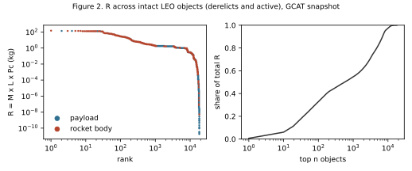
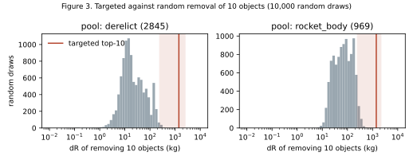

# Ranking low Earth orbit objects by R = M × L × Pc with open catalogue data

| | |
|---|---|
| **Series** | SDC Institute Working Paper SDC-WP-2026-04 |
| **Version** | 0.1, 12 October 2026 |
| **Author** | Maxime Kadri, SDC Institute (in formation) |
| **Status** | Working paper. Open for outside peer review ([how to review](../ROADMAP.md#outside-peer-review)). |
| **Extends** | Kadri & Shishkina (2026), §6 and Figures 2–3; WP-02 §6 items 1–6 |
| **Code** | [`src/sdc/catalogue.py`](../../src/sdc/catalogue.py), [`src/sder/sensitivity.py`](../../src/sder/sensitivity.py), [`scripts/catalogue_report.py`](../../scripts/catalogue_report.py) |
| **Data** | GCAT (McDowell), CC BY 4.0, data update 11 October 2026: [`data/gcat/`](../../data/gcat/) |
| **Competing interests** | See [DISCLOSURES.md](../../DISCLOSURES.md) |
| **Funding** | None |
| **Data availability** | Every number below is in [`results.json`](results.json). `uv run --group research python scripts/catalogue_report.py` regenerates it and the figures from the committed snapshot, and a test fails if the file and the code disagree. |
| **License** | [CC BY 4.0](../../LICENSES/CC-BY-4.0.txt) |

## Abstract

The Strauss Center paper illustrated two claims with synthetic data: a small set of objects holds most of the risk proxy $R_i = M_i L_i Pc_i$ (its Figure 2), and removing the highest-$R$ objects reduces risk far more than removing objects at random (its Figure 3). We test both claims on real data. From the open GCAT catalogue we compute $R_i$, with uncertainty ranges, for 18,036 intact objects in low Earth orbit. Persistence $L$ comes from a drag-decay model run through NRLMSIS 2.1 densities. On 404 rocket bodies that have already reentered, the model's predicted range contains the actual lifetime for 96 % of them, and the median ratio of predicted to actual lifetime is 1.08. Collision probability $Pc$ comes from the kinetic theory of gases, using the catalogue's own spatial density. Among 2,845 derelict intact objects, the top 50 hold 46 % of total $R$. Removing the ten highest-$R$ derelicts gives $\Delta R = 1{,}409$ kg (range 240–2,495), 80 times the median of 10,000 random ten-object removals, and its conservative bound exceeds 99.5 % of those random draws. Both claims hold. We also calibrate two tables of the SDER method, run a sensitivity analysis on 20 real objects, and compare our ranking with published lists of the most concerning derelicts. The comparison shows one weakness of the SDER weighted sum: it rates a derelict 1.3 kg cubesat in the same "high" band as a 9-tonne rocket stage.

## 1 Data

GCAT is a catalogue of every artificial object tracked in space, compiled from public sources by Jonathan McDowell and released under CC BY 4.0 [mcdowell_gcat]. We use three of its files:

- the current orbit of every object (`currentcat`);
- mass and dimensions (`satcat`);
- the list of payloads GCAT records as active (`active`).

The snapshot holds 29,188 objects with apogee below 2,000 km. Of these, 18,868 are intact: payloads and rocket bodies, as opposed to debris and components. GCAT gives a mass for 18,036 of the intact objects, and we rank those. The other 832 are counted but not ranked. [`scripts/fetch_gcat.py`](../../scripts/fetch_gcat.py) rebuilds the extracts, and [`SNAPSHOT.json`](../../data/gcat/SNAPSHOT.json) records their SHA-256.

We chose GCAT over Space-Track because its licence allows redistribution, so anyone can rerun this paper on the same rows.

## 2 Method

Each term is a range (low, point, high). All terms are non-negative, so the bounds of $R$ are products of the bounds of its terms (WP-02 §3). The horizon is $H = 25$ years.

**Mass $M$.** GCAT dry mass, or launch mass if no dry mass is given. The range is ±10 %. When GCAT flags a mass as an estimate, which its documentation describes as "hopefully good to about 20 percent", the range is ±20 %.

**Cross-section $A$.** The object is treated as a cylinder with GCAT's length and diameter. For a randomly tumbling convex body, the mean projected area is a quarter of its surface area (Cauchy's formula), and that is the point value. The range runs from the end-on area to the broadside area including span. Objects without dimensions are sized as a sphere with a bulk density of 100–1,000 kg/m³ (point value 300), which is an assumption.

**Lifetime and persistence $L$.** For a circular orbit, drag gives $\mathrm{d}a/\mathrm{d}t = -\rho B \sqrt{\mu a}$ with $B = C_D A / m$ and $C_D = 2.2$. We integrate it from the object's altitude down to 120 km. Density $\rho$ comes from NRLMSIS 2.1 [emmert2021msis], averaged over longitude and latitude, at three activity levels: F10.7 = 70, 140 and 220 sfu. The point lifetime uses moderate activity at the mean altitude. The shortest plausible lifetime uses high activity, the largest area and the perigee altitude. The longest uses low activity, the smallest area and the mean altitude. Then $L = \min(1, T/H)$.

**Collision probability $Pc$.** $Pc = 1 - \exp(-n v \sigma H)$, after Kessler & Cour-Palais (1978) [kessler1978]. $n$ is the spatial density of all 29,188 catalogued objects (including debris), averaged over the object's altitude range in 10 km shells. Each catalogued object counts in proportion to the share of its altitude range that falls in a shell. $\sigma$ is the object's mean cross-section, and $v$ is a mean relative speed of 10 km/s with a range of 7–13 km/s (an assumption). $Pc$ assumes the object stays where it is over $H$. $L$ accounts separately for its leaving.

**Pools.** "Derelict" means intact and not on GCAT's active list: 2,845 objects. Active satellites are ranked too, but they are not removal candidates.

## 3 Does the lifetime model work?

GCAT records the orbit at a fixed epoch and the reentry date for objects that have decayed. We took every rocket body launched since 1995 that reentered at least 30 days after its orbit epoch, with a perigee of at least 200 km and an apogee below 2,000 km: 404 objects. Payloads are excluded because many lower their own orbits, which a natural-decay model should not be asked to predict.

| Measure | Value |
|---|---|
| Actual lifetime inside the predicted range | 96.0 % |
| Median of predicted / actual (point value) | 1.08 |
| Point value within a factor of 2 | 42.3 % |
| Point value within a factor of 3 | 61.6 % |

The range is wide enough to hold the truth in almost every case. The point value is unbiased but imprecise, mostly because a single moderate density cannot follow the solar cycle. For $R$ this matters little at the top of the ranking. Of the intact objects with perigee above 650 km, 82 % outlive the 25-year horizon even in the shortest-life scenario, so $L = 1$ throughout their range.

## 4 Figure 2 on real data: concentration

| Top n | Share of total R, all intact objects (18,036) | Share of total R, derelict intact objects (2,845) |
|---|---|---|
| 10 | 6.1 % | 13.1 % |
| 50 | 23.8 % | 46.4 % |
| 100 | 32.8 % | 62.8 % |
| 500 | 49.0 % | 86.6 % |

Among derelicts, 50 objects (1.8 % of the pool) hold 46 % of $R$. The shelf near $R \approx 1$ in Figure 2, between ranks 1,000 and 8,000, is 90 % Starlink satellites. They are light, but their shell is dense. They are active, so they are not in the derelict pool.

The top of the ranking:

| Rank | Object | Orbit (km) | M (kg) | L | Pc (25 y) | R [range] |
|---|---|---|---|---|---|---|
| 1 | 23343 Zenit-2 stage 2 | 626–634 | 9,000 | 1.00 | 0.018 | 160 [11–246] |
| 2 | 25400 Zenit-2 stage 2 | 797–812 | 9,000 | 1.00 | 0.016 | 145 [28–224] |
| 3 | 27386 Envisat | 760–762 | 7,911 | 1.00 | 0.018 | 143 [19–541] |
| 4–22 | 18 more Zenit-2 stages and the USA 53 payload | 797–863 | 9,000–12,000 | 1.00 | 0.011–0.015 | 125–138 |

The full top 50 is in [`results.json`](results.json), and `uv run sdc catalogue rank --top 50` prints it.

## 5 Figure 3 on real data: targeted against random removal

| Pool | Targeted top 10: ΔR [range] | Random 10: median | Random 10: 95th percentile | Random 10: maximum | Ratio to median | Random draws below the targeted conservative bound |
|---|---|---|---|---|---|---|
| Derelict intact (2,845) | 1,409 [240–2,495] | 17.5 | 149 | 436 | 80× | 99.5 % |
| Derelict rocket bodies (969) | 1,403 [246–2,166] | 69.3 | 234 | 566 | 20× | 96.1 % |

Removing the ten highest-$R$ derelicts reduces $R$ 80 times as much as removing ten derelicts at random. Even the conservative bound of the targeted set (240) beats 99.5 % of random draws taken at their point value. This is the result the paper's Figure 3 illustrated, now from catalogue data. Liou et al. (2010) [liou2010] reached the same conclusion with full-environment simulations.

## 6 Calibrating SDER: method v0.2

Two SDER tables in v0.1 were placeholders. [`scripts/calibrate_method.py`](../../scripts/calibrate_method.py) now derives them from the data above and writes [`research-v0.2.yaml`](../../src/sder/methodology/research-v0.2.yaml), which becomes the default method. v0.1 stays in the repository, so earlier results can still be reproduced from their hash.

- **Persistence.** The lifetime table holds the decay lifetimes from §2 for the median intact payload in the snapshot ($C_D A/m = 0.0267$ m²/kg), at moderate activity. At 550 km v0.1 assumed about 15 years; v0.2 gives 4.9. At 800 km the figures are 500 and 148 years.
- **Environment.** The band score is the spatial density of catalogued objects per 50 km shell, on a log scale over three decades, with 100 for the densest shell (450–500 km in this snapshot).
- **Unchanged.** Weights, evidence widths, band thresholds, disposal, conjunction, passivation and maneuverability are unchanged and still placeholders. The consequence term keeps $\log_{10} M$. The NASA Standard Breakup Model [johnson2001sbm] makes the fragment count proportional to $M^{0.75}$, so $\log_{10}$ of that count is a linear function of $\log_{10} M$ and ranks objects the same way.

## 7 Case studies and sensitivity

[`scripts/make_cases.py`](../../scripts/make_cases.py) selected 20 real objects across the range of $R$. They are the top-$R$ rocket body from each of the eight most common stage families among the top 500 derelicts, the four highest-$R$ derelict payloads, four active payloads, and four derelict cubesats near 500 km. Each one is an SDER input file in [`examples/cases/`](../../examples/cases/), filled only from GCAT. GCAT records no passivation or conjunction data, and no operator plans for active satellites. Those inputs are left missing, and the engine scores them at worst case.

| Group | SDER score (v0.2) | Status | R |
|---|---|---|---|
| 8 derelict rocket bodies | 79–89, all "high" | provisional | 4.0–160 |
| 4 derelict payloads (Envisat, USA 53, Okean-O, Midori-2) | 83–90, all "high" | provisional | 37–143 |
| 4 active payloads (CX-26, Hubble, a Starlink, a OneWeb) | withheld | 55 % of weight missing | 0.04–147 |
| 4 derelict cubesats (1.3–5.2 kg) | 70–75, all "high" | provisional | 0.0000008–0.0001 |

`sder sensitivity` reports two things for each case.

- **Weights.** Weights drawn from a Dirichlet distribution centred on v0.2 (concentration 100) keep every derelict stage and payload in its band in 100 % of draws. The cubesats keep theirs in 75–97 %.
- **Which input to improve first.** For derelicts, the missing conjunction input accounts for about 70 % of the score's variance. For active satellites, the missing disposal plan accounts for about 63 %.

**What this shows about SDER.** $R$ separates a 9-tonne Zenit stage from a 1.3 kg cubesat by more than eight orders of magnitude. The SDER weighted sum places both in the "high" band, 83 against 70. The score is driven by what the two objects share: no disposal, no maneuvering and missing data. Mass enters only through a 10 % weight on a log scale. This is a defect for a rating meant to scale obligations, and it supports the paper's choice of $\Delta R$, not SDER, to size credits. We propose for v0.3 that the consequence weight, or a multiplier on the whole score, be tied to $R$, and we invite reviewers to propose alternatives.

## 8 Comparison with published lists

The consensus list of the 50 statistically most concerning derelicts (McKnight et al. 2021) [mcknight2021] is not openly available, so we could not compare object by object. Three published facts can be checked against our ranking:

| Published statement | Our top 50 derelicts |
|---|---|
| 39 of the top 50 are rocket bodies, 11 are payloads (Pardini, Rossi & Anselmo 2021, abstract) [pardini2021smc] | 48 rocket bodies, 2 payloads |
| "Greatest debris-generating potential at 775–850 km followed by 975 km and 1,500 km" (McKnight 2021, slides) [mcknight2021gnosis] | 24 of 50 have a mean altitude of 775–850 km; all 50 lie between 622 and 995 km |
| SL-16 (Zenit-2) stages 22285 and 23088 each appear three times among the 200 riskiest conjunctions of July 2020–June 2021 (same slides) | ranked 12th and 14th of 2,845 |

We agree on the region and on the Zenit-2 cluster. We include more rocket bodies for two reasons. First, $R$ weights mass linearly, and the heaviest derelicts are stages. Second, **26 of our top 50 are Chinese upper stages (19 CZ-6A, 5 CZ-12, one CZ-12B and one CZ-10B) launched between November 2022 and July 2026**, after the 2021 list was compiled. GCAT gives each of them a mass of 6,000 kg, or 5,000 kg for the CZ-10B, and flags all 26 masses as estimates. Any list of concerning objects therefore goes out of date within a few years, and it should be recomputed on a fixed schedule from a dated snapshot, as here. One object named in the 2021 slides, Kosmos-1378, reentered on 23 January 2025 according to GCAT, and Kosmos-1536 is ranked 277th.

**Space Sustainability Rating.** We found no public per-mission SSR scores, only rated organisations and tiers, so a quantitative comparison is not yet possible. We would welcome one from anyone holding SSR data.

## 9 Limitations

- **Tracked objects only.** $n$ counts catalogued objects, roughly those larger than 10 cm. Lethal non-trackable debris of 1–10 cm is left out, so $Pc$ is an underestimate whose size we cannot state.
- **Time at altitude.** Each object's time is spread evenly over its altitude range. A real eccentric orbit spends more time near apogee.
- **Relative speed and cross-section.** Both are point assumptions with ranges, not computed from orbital geometry. The cross-section ignores the size of the other object.
- **No conjunction data.** A proper collision probability needs covariance data, which is not public. The Foster or Alfano methods are future work.
- **The solar cycle** is represented only through the range of three fixed activity levels.
- **GCAT masses** for recent objects are often estimates. Their ranges widen, but a systematic error would shift the ranking.
- **$R$ is a proxy.** It is not a probability of catastrophe, and its ranking is not a removal recommendation.

## References

Full entries are in [references.bib](../references.bib): `kadri2026sdc`, `mcdowell_gcat`, `emmert2021msis`, `kessler1978`, `liou2010`, `johnson2001sbm`, `mcknight2021`, `mcknight2021gnosis`, `pardini2021smc`.
